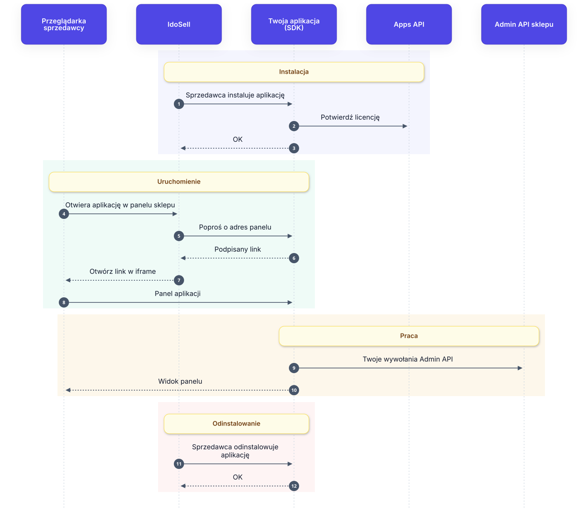
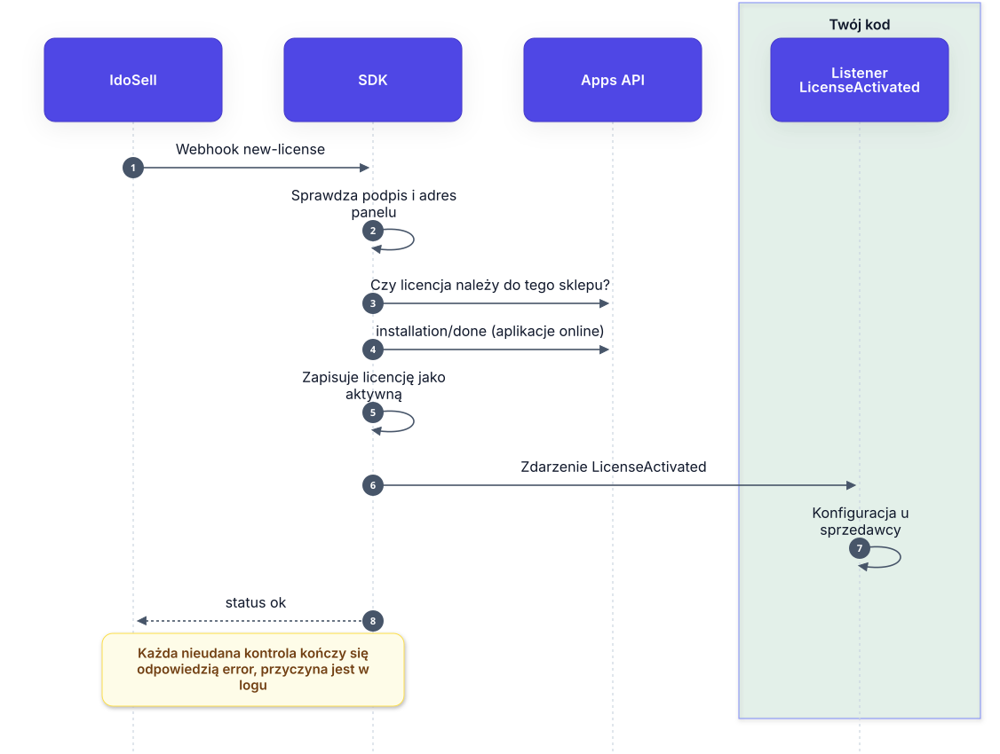
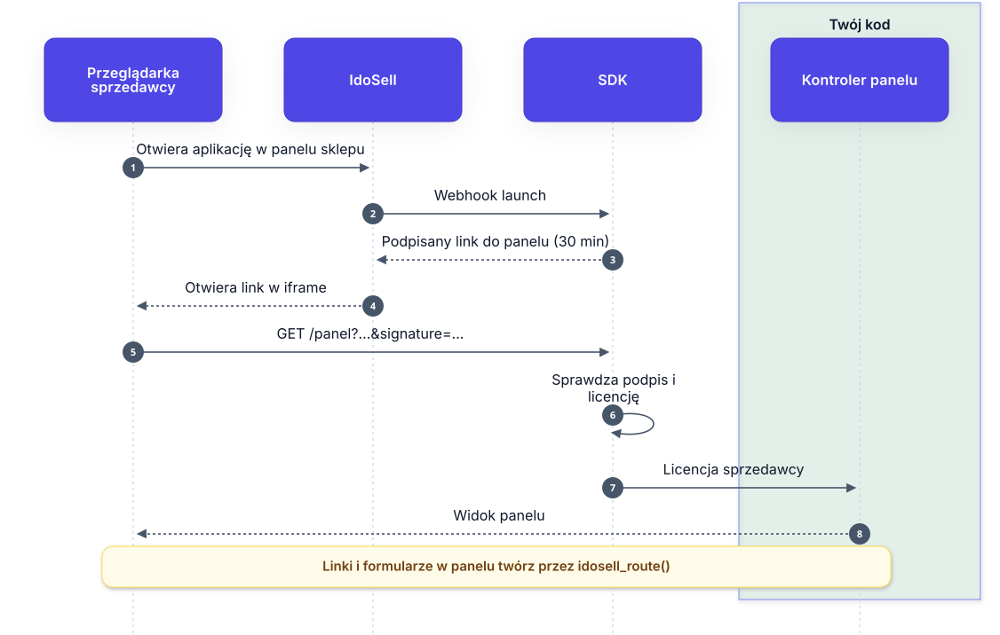
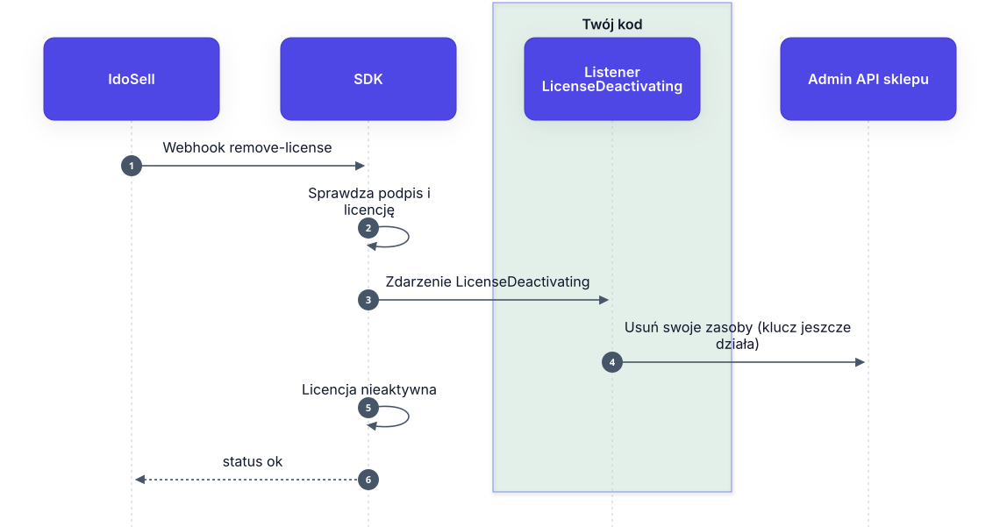

# Jak to działa

## Słowniczek

| Pojęcie | Co to jest |
|---------|-----------|
| **Licencja** | Jedna instalacja Twojej aplikacji u jednego sprzedawcy. SDK zapisuje ją w tabeli `idosell_licenses`. |
| `client_id` | Numer konta sprzedawcy w IdoSell. |
| `application_id` | Numer Twojej aplikacji z panelu dewelopera. |
| `api_url` | Adres Admin API sklepu sprzedawcy, np. `https://clientxxxx.idosell.com/api/admin/`. |
| `api_key` | Klucz sprzedawcy do Admin API. Przychodzi zaszyfrowany, SDK go odszyfrowuje i zapisuje zaszyfrowany w bazie. |
| `api_license` | Numer licencji — identyfikuje instalację w IdoSell (np. przy opłatach). |
| `sign` | Podpis każdego webhooka, liczony z Twojego klucza aplikacji. SDK go sprawdza. |
| **Webhook** | Żądanie, które serwer IdoSell wysyła do Twojej aplikacji: `new-license`, `launch`, `remove-license`. |
| **Podpisany link** | Adres panelu aplikacji z podpisem i terminem ważności (30 min). Po nim SDK rozpoznaje sprzedawcę. |

## Co robi SDK, a co Ty

| SDK | Ty |
|-----|----|
| Odbiera i weryfikuje webhooki, zapisuje licencje | Piszesz panel aplikacji (trasy, kontrolery, widoki) |
| Potwierdza instalację w IdoSell | Opcjonalnie: listener z konfiguracją przy instalacji |
| Wpuszcza do panelu tylko właściwego sprzedawcę | Opcjonalnie: listener sprzątający przy odinstalowaniu |
| Wysyła klucz sprzedawcy tylko do jego panelu IdoSell | Wywołujesz Admin API przez `$license->adminApi()` |

Na diagramach na zielono zaznaczony jest **Twój kod**.

## Całość

Wszystkie webhooki wysyła serwer IdoSell. Przeglądarka sprzedawcy dostaje tylko podpisany link do panelu.

## Instalacja

Sprzedawca instaluje aplikację. SDK sprawdza webhook, potwierdza licencję w IdoSell i zapisuje ją.
Dopiero wtedy uruchamia Twój listener `LicenseActivated`.

Ten sam webhook przychodzi przy ponownej instalacji i przy zmianie licencji (np. wyboru sklepów), dlatego
listener musi znieść ponowne wywołanie. Szczegóły: [04-zdarzenia.md](04-zdarzenia.md).

## Uruchomienie

Sprzedawca otwiera aplikację w panelu sklepu. IdoSell prosi SDK o adres panelu, a SDK zwraca podpisany
link. Twój kontroler dostaje gotową licencję sprzedawcy.

Szczegóły: [03-panel.md](03-panel.md).

## Odinstalowanie

Zanim licencja zostanie wyłączona, SDK uruchamia Twój listener `LicenseDeactivating`. To ostatni moment,
w którym klucz Admin API sprzedawcy działa — usuń wtedy to, co aplikacja dodała w sklepie.

Licencja zostaje w bazie jako nieaktywna (domyślnie). Szczegóły: [04-zdarzenia.md](04-zdarzenia.md).
