# Produkcja i typowe błędy

## Checklista przed produkcją

- [ ] `APP_DEBUG=false`, `LOG_LEVEL=info` (na `debug` logowany jest każdy webhook).
- [ ] `IDOSELL_APP_TYPE=online` (dla aplikacji w iframe) i **brak** `IDOSELL_VERIFY_LICENSE_OWNER=false`.
- [ ] `IDOSELL_APPLICATION_KEY` i `APP_KEY` w menedżerze sekretów, nie w repozytorium.
- [ ] Nie zmieniaj `APP_KEY` — zapisane klucze sprzedawców przestaną się odszyfrowywać.
- [ ] Jeśli opublikowałeś `config/idosell.php` starszą wersją SDK, porównaj go z nową wersją
      (np. `allowed_hosts`) albo opublikuj ponownie: `php artisan idosell:install --force`.

## Typowe błędy

Logi webhooków SDK zapisuje na poziomie `debug` — do diagnozy ustaw tymczasowo `LOG_LEVEL=debug`.

| Objaw | Wpis w logu | Przyczyna | Naprawa |
|-------|-------------|-----------|---------|
| Instalacja się nie udaje | `IdoSell webhook: nieprawidłowy podpis sign.` | zły `IDOSELL_DEVELOPER` lub `IDOSELL_APPLICATION_KEY` | Popraw wartości z panelu dewelopera; `php artisan idosell:doctor`. |
| Instalacja się nie udaje | ``IdoSell new_license: odrzucono `api_url`.`` + host | panel sprzedawcy ma domenę spoza listy | Jeśli to prawdziwy panel IdoSell — dopisz domenę do `IDOSELL_ADMIN_API_ALLOWED_HOSTS`. |
| Instalacja się nie udaje | `IdoSell new_license: aktywacja nieudana.` z `exception: DecryptionException` | zły klucz aplikacji | Popraw `IDOSELL_APPLICATION_KEY`. |
| Instalacja się nie udaje | jak wyżej z `exception: IdosellException` | IdoSell nie potwierdził, że licencja należy do tego sprzedawcy | Zwykle błąd danych po stronie IdoSell albo podrobiony webhook. |
| Instalacja się nie udaje | jak wyżej z `ApiException` / `ConnectionException` | Apps API IdoSell niedostępne | Sprzedawca ponawia instalację później. |
| Instalacja się nie udaje | jak wyżej z inną klasą wyjątku | wyjątek w Twoim listenerze `LicenseActivated` | Popraw listener ([04-zdarzenia.md](04-zdarzenia.md)). |
| Aplikacja się nie otwiera | ``IdoSell launch: brak aktywnej licencji z tym `api_license`.`` | licencja nieaktywna albo usunięta | Sprzedawca instaluje aplikację ponownie. |
| Panel: 403 „Link … nieprawidłowy lub wygasł” | `IdoSell panel: odmowa dostępu.` `reason: signature` | link starszy niż 30 min, link bez podpisu (`route()` zamiast `idosell_route()`), formularz GET, brak `trustProxies` za proxy | Patrz [03-panel.md](03-panel.md). |
| Panel: 403 „Aplikacja nie jest aktywna” | `reason: license` | licencja nieaktywna | Sprzedawca instaluje aplikację ponownie. |
| Panel: 419 przy formularzu | — | CSRF nie wyłączony dla `panel/*` | [03-panel.md](03-panel.md#csrf). |
| Pusty iframe | — (błąd w konsoli przeglądarki) | `X-Frame-Options` / brak `frame-ancestors` | Zezwól na osadzanie ([03-panel.md](03-panel.md#osadzanie-w-iframe-i-nagłówki)). |
| Wyjątek przy `adminApi()` | `IdosellException` „Admin API niedostępne” | instalacja niepotwierdzona w IdoSell | Sprzedawca instaluje aplikację ponownie. |
| Wyjątek przy wywołaniu API | `ApiException` 401/403 | brak uprawnień klucza | Zadeklaruj uprawnienia w panelu dewelopera. |

## Sekrety — co i gdzie

| Sekret | Co musisz zrobić |
|--------|------------------|
| `IDOSELL_APPLICATION_KEY` | trzymać w `.env` / menedżerze sekretów, nigdy w repo |
| `APP_KEY` | nie zmieniać po uruchomieniu produkcji |
| klucze i licencje sprzedawców | nic — SDK szyfruje je w bazie i maskuje w logach |
| podpisany link panelu | nie logować query stringu; nie nadpisywać `Referrer-Policy` |
