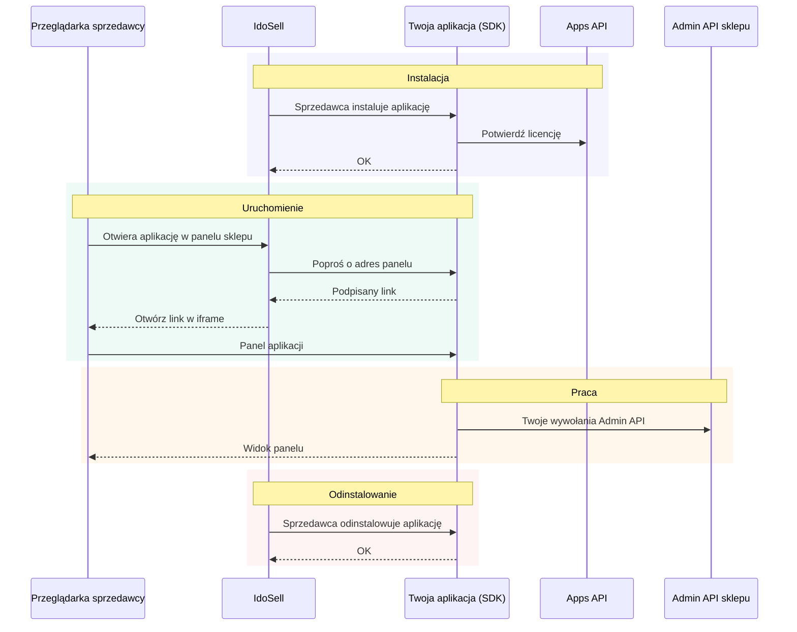
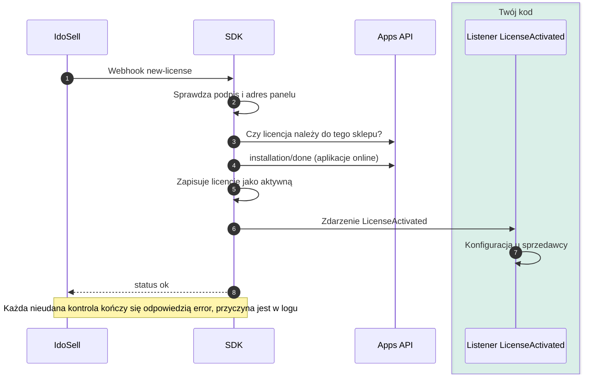
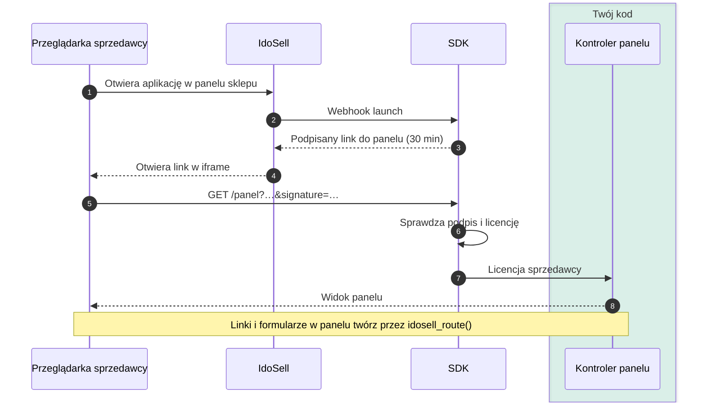
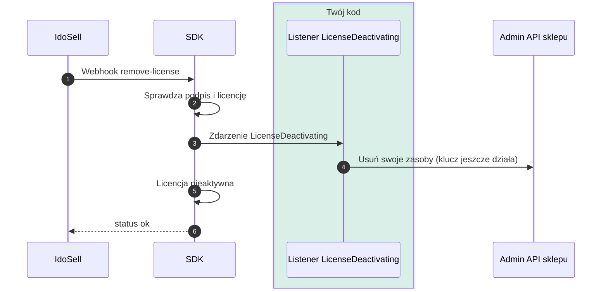
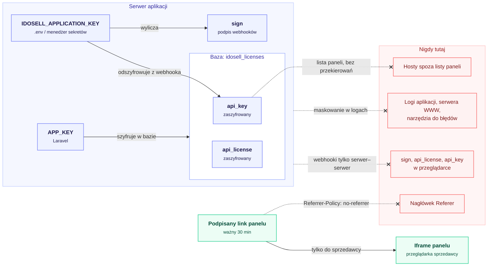

# Źródła diagramów (dla opiekunów SDK)

Diagramy w dokumentacji to pliki `docs/img/diagram-1…6.svg` generowane z tego pliku. Po zmianie
diagramu wygeneruj je ponownie (z katalogu głównego repo):

```bash
docker run --rm -u "$(id -u):$(id -g)" -v "$PWD":/data minlag/mermaid-cli \
  -i docs/img/diagramy-zrodlo.md -o docs/img/diagram.md \
  -c docs/img/mermaid-config.json -C docs/img/mermaid.css -b white -s 2 \
  && rm docs/img/diagram.md
```

Kolejność diagramów = numer pliku SVG. Diagramy muszą odpowiadać kodowi (`ActivateLicense`,
`WebhookController`, `EnsureIdosellLicense`, `AdminApiClient`, `DeactivateLicense`).

## 1. Przegląd (docs/02)



## 2. Instalacja (docs/02)



## 3. Uruchomienie (docs/02)



## 4. Odinstalowanie (docs/02)



## 5. Wywołanie Admin API (docs/05)

```mermaid
flowchart LR
    A(["<b>Wywołanie<br/>Admin API</b>"]) --> C1["<b>Instalacja potwierdzona</b><br/><small>aplikacje online</small>"]
    C1 --> C2["<b>https</b>"]
    C2 --> C3["<b>Publiczna domena</b><br/><small>bez IP i domen wewnętrznych</small>"]
    C3 --> C4["<b>Domena na liście paneli</b><br/><small>IDOSELL_ADMIN_API_ALLOWED_HOSTS</small>"]
    C4 --> C5["<b>Ścieżka względna</b>"]
    C5 --> G["<b>Żądanie do panelu</b><br/><small>X-API-KEY, bez przekierowań</small>"]
    G -- 2xx --> OK(["<b>JSON</b>"])
    G -. "błąd" .-> X6["<b>ApiException</b>"]

    classDef check fill:#f8fafc,stroke:#94a3b8,stroke-width:1.5px,color:#0f172a
    classDef bad fill:#fef2f2,stroke:#f87171,stroke-width:1.5px,color:#7f1d1d
    classDef good fill:#ecfdf5,stroke:#34d399,stroke-width:1.5px,color:#064e3b
    classDef key fill:#eef2ff,stroke:#818cf8,stroke-width:1.5px,color:#1e1b4b
    class C1,C2,C3,C4,C5 check
    class X6 bad
    class OK good
    class A,G key
```



## 6. Sekrety (docs/07)


